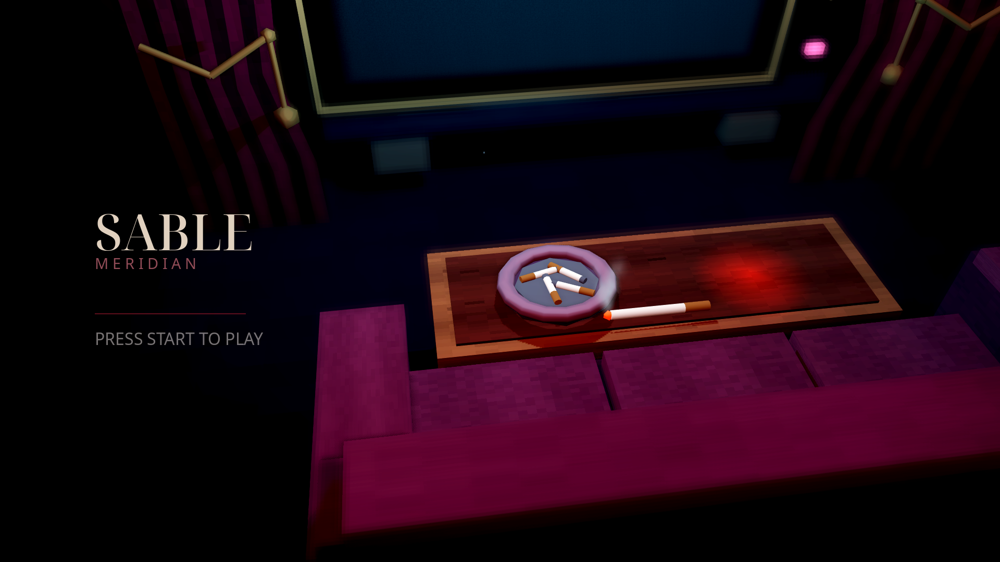

<p align="center">
  
</p>

<h1 align="center">SABLE MERIDIAN</h1>

<p align="center">
  <i>Dark fantasy teatral em 3D — um bobo sombrio atravessa um palco gótico de oito mundos.</i>
</p>

<p align="center">
  
  
  
  
  
  
  <a href="https://github.com/Okamihere/SABLE-MERIDIAN/actions/workflows/validate.yml"></a>
</p>

> **Godot 4.7 · GDScript · GL Compatibility · 1920×1080** — ação 3D estilizada low-poly PS1/PS2 em roxo, vinho e dourado. Pátio de treino → hub vertical com oito mundos → bosses com chaves e recompensas. Foco atual: movimento, combate e apresentação visual.

## Sinopse

Sob holofotes de névoa, o **Veyl** — bobo de corte em traje carmesim — acorda num teatro em ruínas. A **Contrarregra** o aguarda no pátio: pegue o cajado, aprenda o compasso do combate e atravesse a névoa. Cada porta do hub abre um mundo com seu próprio boss; cada boss rende uma **chave** — e o primeiro, a **Lâmina do Eco**.

## Destaques

- Combate teatral: combos de 4 golpes com launcher, ataques aéreos, esquiva com invulnerabilidade, **esquiva perfeita em câmera lenta** e ranking de estilo **D–S**.
- **6 armas jogáveis**, cada uma com skills **Q/E/R**: Cajado, Adagas de Cartas, Fios de Marionete, Bengala-Lâmina, Grimório Vivo (modelo 3D) e Lâmina do Eco (recompensa do mundo 01).
- Máscara do Riso (`Tab`), relíquia Bilhete do Bis, magias de cartas com mana e cooldown reais.
- Hub vertical com **8 mundos**, chaves persistentes, portais de retorno e mundo 02 com temática aquática.
- Tela press-start cinematográfica com voo de câmera, TV de título 3D interativa, HUD de vela com HP/MP, pausa e opções persistentes (presets LOW–ULTRA, modo sem bordas, confirmação de tela).
- Sprite 8-direções com animação procedural, lock-on com botão do meio, saltos em parede com orbes, iluminação toon e shaders próprios (névoa, CRT, água estilizada).

## Os oito mundos

| # | Mundo | Tema |
| --- | --- | --- |
| 01 | Coro Afundado | Ciclo completo: exploração → combate → boss → chave + Lâmina do Eco |
| 02 | Galeria dos Espelhos | Percurso aquático |
| 03 | Poço das Cordas | Graybox de travessia e combate |
| 04 | Nave Partida | Graybox de travessia e combate |
| 05 | Arquivo Suspenso | Graybox de travessia e combate |
| 06 | Ponte dos Ecos | Graybox de travessia e combate |
| 07 | Camarotes Vazios | Graybox de travessia e combate |
| 08 | Torre do Silêncio | Graybox de travessia e combate |

## Galeria

| Tela press-start (nova) |
| --- |
|  |

| Pátio + HUD |
| --- |
|  |

| Grimório vivo 3D | Skill do grimório |
| --- | --- |
|  |  |

| Título 3D | Opções |
| --- | --- |
|  |  |

| Névoa de passagem | Vídeo |
| --- | --- |
|  | [gameplay.mp4](docs/gameplay.mp4) (13 s, skills Q/E/R do grimório) |

## O que já funciona

- Combos de quatro golpes com launcher, ataques aéreos, esquiva com invulnerabilidade e esquiva perfeita com câmera lenta.
- Movimento e saltos em paredes, com limite ampliado por orbes coletadas; foco em alvos e ranking de estilo D–S.
- No pátio, o cajado e os expositores apresentam as armas: `1`/`2`/`3` selecionam Cajado, Adagas de Cartas e Lâmina do Eco (após o mundo 01); aproximar-se dos outros expositores equipa as demais. `Tab` alterna a Máscara do Riso. O Bilhete do Bis recarrega o Baralho Maldito após uma esquiva perfeita.
- HUD de vida e mana com avisos contextuais, interação e diálogo com NPC, pausa e opções persistentes de vídeo, áudio e câmera — incluindo presets LOW/MEDIUM/HIGH/ULTRA/CUSTOM, modo sem bordas, confirmação de 15 s para mudanças de tela e descrições contextuais.
- O **Grimório Vivo** é um modelo 3D (`assets/3d model/grimorio.glb`): aparece equipado ao lado do jogador e girando no pedestal do pátio.
- Ao entrar na fase, o mouse é capturado automaticamente para a câmera (clique recaptura se necessário).
- Passagem física com névoa entre o pátio e o hub, iluminação toon e personagem em `AnimatedSprite3D` com oito direções. O modelo 3D permanece oculto na apresentação atual.

Um adereço 3D junto ao sprite identifica a arma equipada; a máscara e a relíquia ainda não têm indicação no sprite/HUD. A troca de arma durante um golpe é aplicada na próxima janela do combo. Q/E/R consomem mana conforme a skill; Mouse1/Mouse2 não consomem.

O progresso salvo inclui orbes de salto em parede e chaves dos mundos. **Continuar** retorna ao pátio quando há progresso; posição e combate não são salvos. **Novo jogo** limpa tudo.

## Controles

| Entrada | Ação |
| --- | --- |
| `WASD` | Mover |
| `Espaço` | Pular ou saltar da parede |
| `Shift` | Esquivar |
| Mouse esquerdo / direito | Ataques básicos da arma equipada, sem custo de mana |
| Mouse do meio | Focar ou liberar alvo |
| `Q` / `E` / `R` | Skills da arma equipada |
| `1` / `2` / `3` | Cajado / Adagas de Cartas / Lâmina do Eco; outras armas nos expositores |
| `Tab` | Equipar ou retirar a Máscara do Riso |
| `F` | Interagir; revelar ou avançar diálogo; entrar nas portas do hub |
| Roda do mouse | Aproximar ou afastar câmera |
| `Esc` | Pausa, voltar das opções ou encerrar diálogo |
| `F3` | Informações de depuração |

Na tela inicial, use mouse ou setas e `Enter` para selecionar. A lista de atalhos também aparece na tela inicial e na pausa.

## Executar

1. Abra esta pasta no **Godot 4.7.x** com o renderizador **GL Compatibility**.
2. Execute o projeto com `F5`. A cena inicial é `scenes/ui/press_start.tscn` (cinemática → título → pátio).
3. Pegue o cajado no centro do pátio e atravesse a névoa sob o arco para chegar ao hub. O mouse é capturado ao entrar na fase; clique recaptura se preciso.

## Documentação

- [Arquitetura](docs/architecture.md) · [Equipamento](docs/equipment.md) · [Habilidades](docs/combat_abilities.md)
- [Contribuição](docs/contributing.md) · [Validação](docs/validation.md) · [Roadmap](docs/roadmap.md) · [Contexto p/ IA](AI_CONTEXT.md)

<details>
<summary><b>Estrutura do projeto</b></summary>

```
scenes/levels   pátio (start_room) + hub vertical + mundos 01–08 + portal (fog_gate)
scenes/player   player_rig (em uso) + camera_rig + armas
scenes/ui       press_start → title_screen → hud / pause / diálogo
scripts/player  movimento, sprite 8-dir, animação procedural, lock-on, parede
scripts/combat  combos, hitboxes, input buffer
resources/      6 armas · 24 ataques · 18 spells · máscaras · relíquia
tools/          validate_project.py + 24 testes headless
```

</details>

Licença: [MIT](LICENSE).
